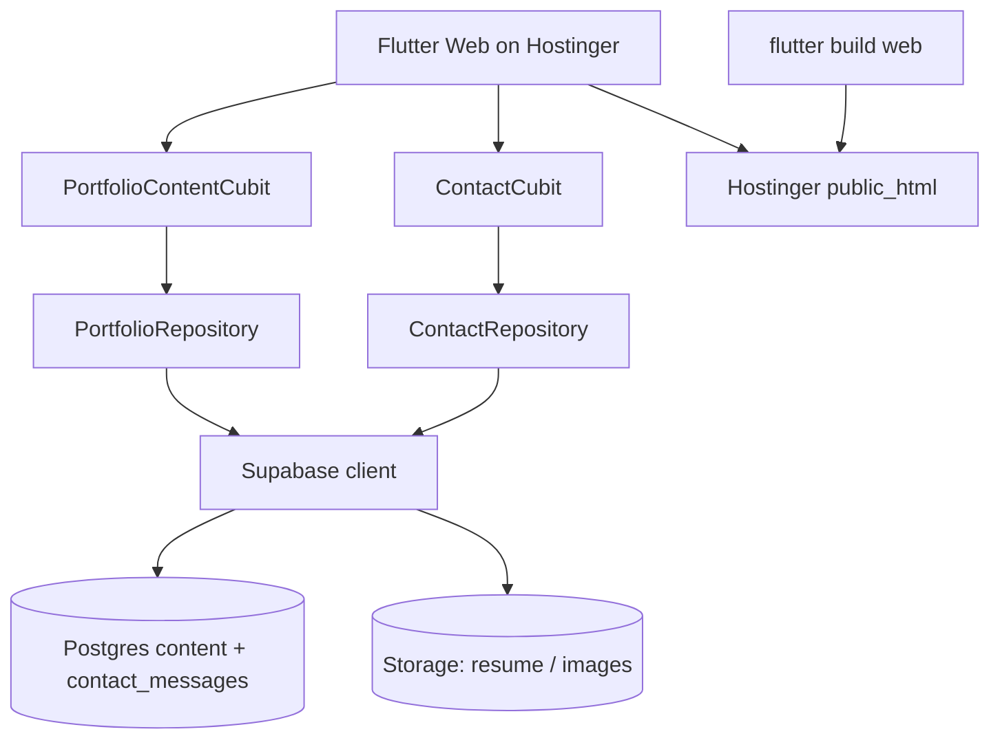

# Supabase Dynamic Portfolio (Web + Hostinger + Contact)

## Decisions (locked in)

- **Backend:** Supabase (DB, Storage for resume/images, Contact Us)
- **Project name:** `Ahmed Portfolio`
- **Organization:** `ahmed emad Org` (`fnawgsfrsykuogiikrme`)
- **Region:** `eu-central-1`
- **App target:** Flutter **web**
- **Hosting:** **Hostinger** (not Supabase Storage). Deliver a markdown guide `[HOSTINGER_DEPLOY.md](HOSTINGER_DEPLOY.md)` with exact publish steps
- **Routing on Hostinger:** path URL strategy + Apache `.htaccess` SPA fallback to `index.html` (standard for Hostinger shared hosting)
- **Contact Us:** persist in `contact_messages`
- **Social / AE Studio / CV:** dynamic from Supabase; seed placeholders unless you provide real URLs

## Architecture

## 1. Create Supabase project

1. `get_cost` → confirm → `confirm_cost` → `create_project` name `Ahmed Portfolio`, region `eu-central-1`
2. Fetch URL + anon/publishable key
3. Web builds use `--dart-define=SUPABASE_URL=...` and `--dart-define=SUPABASE_ANON_KEY=...`

## 2. Database schema + Storage

Public-read RLS for CMS content. Contact: **INSERT-only** for anon.

| Table                         | Purpose                                                 |
| ----------------------------- | ------------------------------------------------------- |
| `profile`                     | name, title, about, AE Studio label/URL, resume URL     |
| `social_links`                | github/linkedin/email/whatsapp/cv/x, url, sort, enabled |
| `services`                    | title, description, sort                                |
| `skill_categories` + `skills` | nested skills                                           |
| `experiences`                 | role, period, context, bullets                          |
| `projects`                    | slug, copy, arrays, `image_url`, role                   |
| `contact_messages`            | name, email, phone, message, created_at                 |

**Storage:** `portfolio-public` only (resume + project images). No `site` bucket — Hostinger serves the web app.

## 3. Flutter web integration

Same as before: `supabase_flutter`, content cubit + fallback, wire UI + contact insert, dynamic links.

For Hostinger path routing: enable path URL strategy and ship `.htaccess` with the build (or document copying it into `public_html`).

## 4. Hostinger publish document (`[HOSTINGER_DEPLOY.md](HOSTINGER_DEPLOY.md)`)

Create a clear markdown guide in the repo covering:

1. **Prerequisites** — Flutter SDK, Hostinger hosting plan, domain pointed at Hostinger
2. **Build command** — `flutter build web --release` with Supabase dart-defines
3. **What to upload** — contents of `build/web/` (not the folder itself) into `public_html` (or subdomain folder)
4. **Upload methods** — Hostinger File Manager (zip + extract) and FTP/SFTP
5. **SPA rewrite** — sample `.htaccess` so `/portfolio`, `/contact`, etc. refresh correctly
6. **Supabase CORS / Site URL** — note to allow the Hostinger domain if needed
7. **Verify checklist** — home loads, sections navigate, social/CV open, contact form writes to Supabase
8. **Update workflow** — rebuild → re-upload → clear cache

This file is the Hostinger “publish playbook”; Supabase remains backend only.

## 5. Editable later (no Hostinger redeploy for content)

Edit socials, AE Studio, resume, about, projects, and view contact messages in Supabase dashboard. Redeploy to Hostinger only for code/UI changes.

## Out of scope

- Firebase
- Supabase Storage as the website host
- Admin CMS UI
- Native store release pipelines

## Execution prerequisites

Cost confirmation before creating the Supabase project.