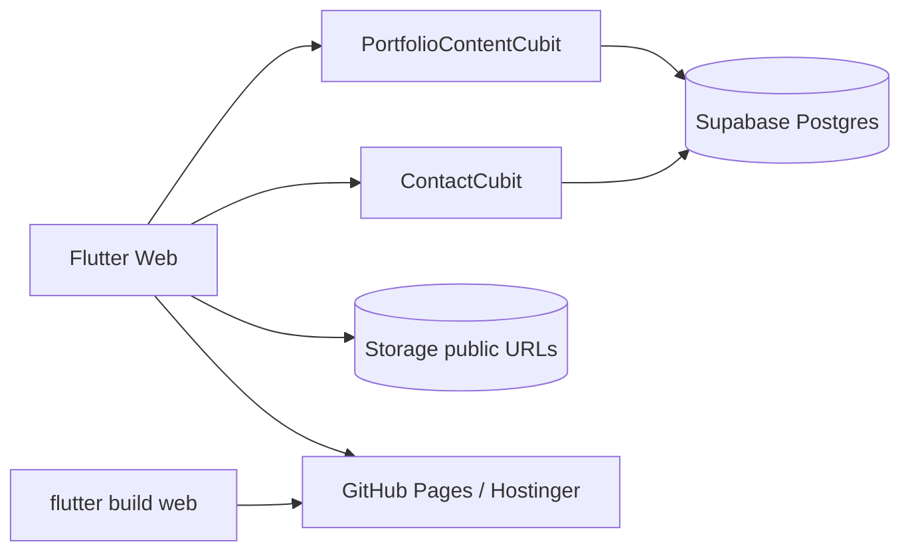

# Supabase System & Web Deploy

This document describes how **Ahmed Emad Portfolio** uses Supabase (database + storage), how the Flutter web app talks to it, and how to build and publish the site.

---

## Overview

| Layer | Role |
|--------|------|
| **Supabase** | Backend only: Postgres content, Contact Us inserts, public Storage for resume/images |
| **Flutter web** | Frontend SPA; loads content at startup; submits contact form |
| **GitHub Pages** | Recommended static host (`gh-pages` branch) |
| **Hostinger** | Optional alternate static host (see [`HOSTINGER_DEPLOY.md`](../HOSTINGER_DEPLOY.md)) |

**Do not** host the Flutter web app from Supabase Storage for production. Storage serves HTML as plain text / sandboxed responses, so the UI will not run correctly in browsers. Use GitHub Pages or Hostinger for the site; keep Supabase for API + assets.



---

## Supabase project

| Field | Value |
|--------|--------|
| Project | The owner's existing, active project (shared with other apps) |
| Schema | `portfolio` (all tables live here, nothing in `public`) |
| API URL | `https://<ref>.supabase.co` (passed at build time) |
| Client config | [`lib/core/supabase/supabase_config.dart`](../lib/core/supabase/supabase_config.dart) |

The original standalone project (`tptaqfbmqifzewewnudg`) was paused. Its content
moves into the `portfolio` schema of the active project (see below).

Dart defines (no URL/key is baked in):

- `SUPABASE_URL`: required for live content
- `SUPABASE_ANON_KEY`: publishable key (or legacy anon JWT)
- `SUPABASE_SCHEMA`: defaults to `portfolio`

Init path: [`lib/main.dart`](../lib/main.dart) → `Supabase.initialize(postgrestOptions: schema)` → `ServiceLocator` → `PortfolioContentCubit.load()`.

If the defines are missing or the backend is unreachable, the site still renders
the bundled `PortfolioContent.fallback`. The contact form is the only feature
that needs the backend.

---

## Setting up the `portfolio` schema

1. **Schema + RLS + grants:** SQL Editor → run
   [`supabase/migrations/20261003_portfolio_schema.sql`](../supabase/migrations/20261003_portfolio_schema.sql).
   Idempotent, and touches nothing outside `portfolio`.
2. **Expose it:** Settings → API → **Exposed schemas** → add `portfolio` → Save.
   Without this the REST API returns `PGRST106` / 406.
3. **Content**, using one of these:
   - **Real data from the old project (preferred).** Restore the old project in the Dashboard, then on your machine:
     ```bash
     supabase db dump --db-url "$OLD_DB_URL" --schema public -f old_schema.sql
     supabase db dump --db-url "$OLD_DB_URL" --schema public --data-only -f old_data.sql
     ./scripts/rewrite_dump_to_portfolio.sh old_data.sql > portfolio_data.sql
     ```
     Compare `old_schema.sql` with the migration's column list first. If a column
     exists only in the old schema, add it to the migration before loading. Then run
     `portfolio_data.sql` in the SQL Editor (or `psql "$NEW_DB_URL" -f portfolio_data.sql`).
     It replaces all `portfolio` rows, including `contact_messages`, inside one transaction.
   - **Old project is gone.** Run
     [`supabase/seed/portfolio_seed_from_repo.sql`](../supabase/seed/portfolio_seed_from_repo.sql).
     It rebuilds content from the repo. `contact_messages` history, store links and
     Storage URLs are lost.
4. **Storage is not migrated.** Re-upload the CV and images to the active project's
   Storage (or anywhere public), then set `profile.resume_url`, the `cv` row in
   `social_links`, and `projects.*_url`.
5. **Verify:**
   ```bash
   curl "$SUPABASE_URL/rest/v1/profile?select=display_name" \
     -H "apikey: $SUPABASE_ANON_KEY" -H "Accept-Profile: portfolio"
   ```

`supabase/migrations/20260807_*.sql` now target `portfolio.` too. Their content
is already in the seed, so you only need them to re-apply those updates.

---

## Database (`portfolio` schema)

All content tables have **RLS enabled**. Intended policies:

- **Content tables:** `anon` / `authenticated` **SELECT** (public read)
- **`contact_messages`:** `anon` **INSERT** only (no public read)

### Tables

#### `profile` (single row)

Hero / about / footer identity.

| Column | Purpose |
|--------|---------|
| `display_name` | Hero name |
| `title` | Job title |
| `about` | About section body |
| `ae_studio_label` | Footer design credit label |
| `ae_studio_url` | Footer link |
| `resume_url` | Public CV URL (usually Storage) |
| `skills_subtitle` | Skills section subtitle |

#### `social_links`

| Column | Purpose |
|--------|---------|
| `key` | Stable id: `github`, `linkedin`, `email`, `whatsapp`, `cv`, `x`, … |
| `url` | Destination (mailto / https / wa.me) |
| `sort_order` | Display order |
| `is_enabled` | Hide without deleting |

App resolves CV via social key `cv`, falling back to `profile.resume_url` when the link URL is empty.

#### `services`

| Column | Purpose |
|--------|---------|
| `title`, `description`, `sort_order` | Services cards |

#### `skill_categories` + `skills`

| Table | Key columns |
|--------|-------------|
| `skill_categories` | `title`, `sort_order` |
| `skills` | `category_id`, `name`, `proficiency` (0–100), `color_hex`, `sort_order` |

UI shows skill names as chips (proficiency is stored but not shown as a progress bar).

#### `experiences`

| Column | Purpose |
|--------|---------|
| `role` | Job title |
| `company` | Employer name |
| `period` | Date range (e.g. `Aug 2025 – Present`) |
| `context` | Work mode / location (e.g. `Onsite · Mansoura`, `Remote`) |
| `bullets` | `text[]` achievement bullets |
| `tech_tags` | `text[]` tech chips shown under each role |
| `sort_order` | Newest-first order (lower = higher on screen) |

Schema + seed for the resume-backed timeline:
[`supabase/migrations/20260807_experiences_company_tech_tags.sql`](../supabase/migrations/20260807_experiences_company_tech_tags.sql)

Apply in Supabase Dashboard → **SQL Editor** → paste/run that file (adds columns and replaces rows).

#### `projects`

| Column | Purpose |
|--------|---------|
| `slug` | Stable id / route id (`taggz`, `iconcierge`, …) |
| `title`, `short_description`, `full_description` | Copy |
| `image_url` | Cover image **public URL** (preferred for remote images) |
| `image_key` | Local asset fallback key (`taggz`, `iconcierge`, `wepick`, `alltraders`, …) |
| `tech_stack`, `features` | `text[]` |
| `role` | Role line on details |
| `sort_order` | List order |
| `google_play_url`, `app_store_url`, `video_url`, `github_url`, `apk_url`, `web_url` | Store/source links (empty → icon hidden) |
| `supports_windows` | Windows badge / link affordance |
| `preview_image_1_url` / `preview_image_1_key` | Portfolio desktop mockup slot 1 |
| `preview_image_2_url` / `preview_image_2_key` | Portfolio desktop mockup slot 2 |

**Image resolution (app):**

1. Use `*_url` when non-empty (network).
2. Else use `*_key` / `image_key` mapped to bundled assets in [`ProjectImageResolver`](../lib/core/utils/project_image_resolver.dart).
3. Portfolio **mobile** cover uses `image_url` / `image_key`.
4. Portfolio **desktop** mockups use preview fields, then fall back to cover.

#### `contact_messages`

Written by the Contact form ([`ContactRemoteDataSource`](../lib/features/contact/data/data_source/contact_remote_data_source.dart)).

| Column | Purpose |
|--------|---------|
| `name`, `email`, `phone`, `message` | Form fields |
| `created_at` | Server timestamp |

---

## Storage

### Buckets

| Bucket | Public | Purpose |
|--------|--------|---------|
| `portfolio-public` | Yes | **Canonical** asset bucket: resume PDFs, project images |
| `site` | Yes | Legacy / experimental static hosting attempts — **not** used for production site serving |

### Public URL form

```text
https://<ref>.supabase.co/storage/v1/object/public/<bucket>/<object-path>
```

Example resume:

```text
https://<ref>.supabase.co/storage/v1/object/public/portfolio-public/resumes/ahmed-emad-cv.pdf
```

After upload, paste that URL into `profile.resume_url` and/or `social_links` where `key = 'cv'`.

### Recommended paths in `portfolio-public`

Use stable, kebab-case paths so URLs stay predictable:

| Path | Use |
|------|-----|
| `resumes/ahmed-emad-cv.pdf` | Latest CV (preferred over loose root PDFs) |
| `projects/<slug>/cover.png` | Project cover → `projects.image_url` |
| `projects/<slug>/preview-1.png` | Desktop mockup 1 → `preview_image_1_url` |
| `projects/<slug>/preview-2.png` | Desktop mockup 2 → `preview_image_2_url` |
| `projects/<slug>/apk/<name>.apk` | Optional APK → `apk_url` |

`<slug>` must match `projects.slug` (e.g. `iconcierge`, `taggz`, `wepick`, `all-traders`).

### Paths used in the old project (not migrated; re-upload as needed)

**`portfolio-public/`** (root-level PDFs today):

```text
portfolio-public/
  AhmedEmadCV2025.pdf
  Ahmed_Emad_El_deen_Lotfy_-_FLUTTER_SOFTWARE_ENGINEER.pdf
  AHMED_EMAD_EL_DEEN_LOTFY_-_FLUTTER_SOFTWARE_ENGINEER (1).pdf
```

**`site/`** (legacy web upload — do not rely on for production):

```text
site/
  index.html
  main.dart.js
  flutter.js
  flutter_bootstrap.js
  assets/…
  canvaskit/…
  icons/…
  www/…          # prefix used by scripts/upload_site_to_supabase.mjs
```

Upload script for the legacy `site` bucket: [`scripts/upload_site_to_supabase.mjs`](../scripts/upload_site_to_supabase.mjs) (`BUCKET=site`, `PREFIX=www`). Prefer GitHub Pages instead.

### Uploading assets (Dashboard)

1. Supabase → **Storage** → `portfolio-public`
2. Create folders as needed (`resumes/`, `projects/iconcierge/`, …)
3. Upload file → **Copy URL** / build public URL as above
4. Set the matching column on `profile` or `projects` in **Table Editor**

No Flutter redeploy is required for content or Storage URL changes.

---

## Flutter client flow

| Piece | Location |
|--------|----------|
| Config | `lib/core/supabase/supabase_config.dart` |
| DI | `lib/core/utils/service_locator.dart` |
| Content fetch | `lib/features/shared/data/data_source/shared_remote_data_source.dart` |
| Content state | `lib/features/shared/presentation/logic/portfolio_content_cubit.dart` |
| Contact insert | `lib/features/contact/data/data_source/contact_remote_data_source.dart` |

The cubit starts with bundled `PortfolioContent.fallback` and swaps in Supabase content when the fetch succeeds. On failure the fallback stays on screen.

---

## Web build

### Prerequisites

- Flutter SDK on `PATH`
- Network access for `flutter pub get` / CDN
- Valid Supabase URL + publishable/anon key

### Release build (generic)

```bash
flutter pub get

flutter build web --release \
  --dart-define=SUPABASE_URL=https://YOUR_REF.supabase.co \
  --dart-define=SUPABASE_ANON_KEY=YOUR_PUBLISHABLE_KEY \
  --dart-define=SUPABASE_SCHEMA=portfolio \
  --dart-define=USE_PATH_URL=true
```

Output: `build/web/`

| Define | Meaning |
|--------|---------|
| `SUPABASE_URL` | Project API URL |
| `SUPABASE_ANON_KEY` | Publishable or anon key |
| `USE_PATH_URL` | `true` (default): path URLs + `usePathUrlStrategy()`. `false`: hash URLs (useful if the host cannot rewrite SPA routes) |

### GitHub Pages build extras

Project site base path must match the repo name:

```bash
flutter build web --release \
  --base-href=/ahmed_portfolio/ \
  --dart-define=USE_PATH_URL=true \
  --dart-define=SUPABASE_URL=https://YOUR_REF.supabase.co \
  --dart-define=SUPABASE_ANON_KEY=YOUR_PUBLISHABLE_KEY
```

---

## Deploy

### A) GitHub Pages (recommended)

Script: [`scripts/deploy_github_pages.sh`](../scripts/deploy_github_pages.sh)

```bash
./scripts/deploy_github_pages.sh
```

What it does:

1. `flutter pub get` + `flutter build web --release` with `--base-href=/ahmed_portfolio/` and Supabase defines
2. Copies `index.html` → `404.html` (SPA deep-link fallback on GitHub Pages)
3. Adds `.nojekyll`
4. Force-pushes `build/web` to branch `gh-pages`

Live URL:

```text
https://ahmed-emad30.github.io/ahmed_portfolio/
```

Repo settings: **Settings → Pages → Deploy from a branch → `gh-pages` / root**.

| Env var | Default | Purpose |
|---------|---------|---------|
| `REPO_NAME` | `ahmed_portfolio` | Base href + Pages path |
| `GH_PAGES_BRANCH` | `gh-pages` | Target branch |
| `SUPABASE_URL` / `SUPABASE_ANON_KEY` | required | Build-time backend |
| `SUPABASE_SCHEMA` | `portfolio` | Postgres schema |
| `USE_PATH_URL` | `true` | URL strategy |
| `SKIP_BUILD=1` | off | Redeploy existing `build/web` |
| `DRY_RUN=1` | off | Build only, no push |

### B) Hostinger

See [`HOSTINGER_DEPLOY.md`](../HOSTINGER_DEPLOY.md):

1. Build web (usually `--base-href=/` for domain root)
2. Upload **contents** of `build/web/` to `public_html`
3. Ensure [`web/.htaccess`](../web/.htaccess) is present for SPA rewrites

### C) Supabase Storage hosting (not supported)

Uploading `build/web` into bucket `site` / `site/www/` does **not** work as a real website host (wrong content types / CSP). Keep that bucket only as a historical artifact unless cleaned up.

---

## Content vs code updates

| Change | Action |
|--------|--------|
| Copy, links, resume URL, project images | Edit Supabase tables / Storage only |
| UI, routing, Flutter logic | Rebuild web + redeploy host |
| New Storage file | Upload + set URL column |

---

## Verify checklist

- [ ] Site loads over HTTPS
- [ ] Sections navigate; refresh on a deep path still works (404.html or `.htaccess`)
- [ ] About / skills / projects match Table Editor (not the bundled fallback)
- [ ] Social + CV / resume open
- [ ] Contact form creates a `contact_messages` row
- [ ] Project covers use `image_url` when set; otherwise `image_key` local asset

---

## Troubleshooting

| Symptom | Likely fix |
|---------|------------|
| Site shows bundled content, not DB edits | Check build defines, `portfolio` in Exposed schemas, RLS SELECT + grants |
| REST `406` / `PGRST106` | `portfolio` not in Settings → API → Exposed schemas |
| Contact submit fails | RLS INSERT on `contact_messages`; browser console errors |
| Wrong / missing project image | Set `image_url` to Storage public URL; or fix `image_key` |
| GitHub Pages blank | Confirm `--base-href=/ahmed_portfolio/` and Pages source = `gh-pages` |
| Deep link 404 on Pages | Ensure deploy script wrote `404.html` |
| Deep link 404 on Hostinger | Ensure `.htaccess` uploaded |
| Edited Supabase but old UI | Hard refresh; ensure you did not expect Storage-hosted HTML to update the app |
